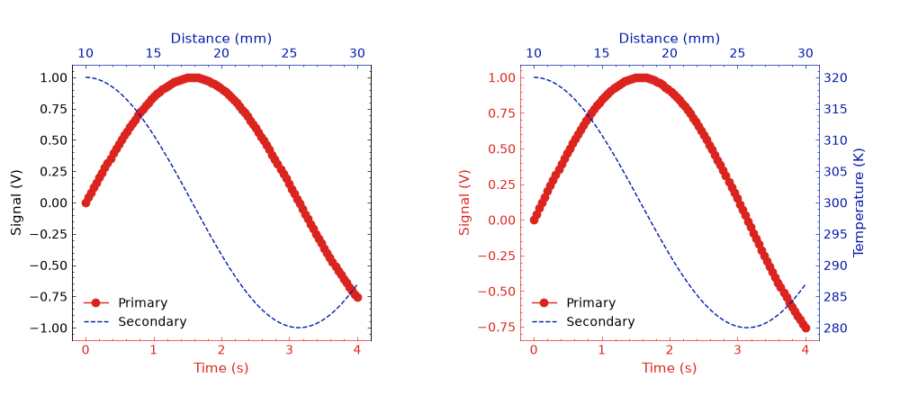

Double X and XY Axis Context Managers
=============================================

:py:class:`stonerplots.DoubleXAxis` adds a top x-axis with an independent scale,
sharing the original y-axis. :py:class:`stonerplots.DoubleXYAxis` adds independent
top x and right y scales. Both return a single Matplotlib ``Axes`` for plotting
the second dataset. See :doc:`Double-axis context managers <doubleaxis>` for
an overview of all three variants and their shared options.

Basic Usage
-----------

Use ``DoubleXAxis`` when two datasets have different horizontal coordinates
but share a vertical scale::

    import matplotlib.pyplot as plt
    from stonerplots import DoubleXAxis, DoubleXYAxis

    fig, ax = plt.subplots()
    ax.plot([0, 1, 2], [0, 1, 0], label="Primary")
    ax.set(xlabel="Time (s)", ylabel="Signal (V)")
    with DoubleXAxis(ax=ax, colours=("central", "piccadilly")) as ax2:
        ax2.plot([10, 20, 30], [0, 0.8, 0], label="Secondary", color="piccadilly")
        ax2.set_xlabel("Distance (mm)")

Use ``DoubleXYAxis`` when both coordinates require separate scales::

    fig, ax = plt.subplots()
    ax.plot([0, 1, 2], [0, 1, 0], label="Primary")
    ax.set(xlabel="Time (s)", ylabel="Signal (V)")
    with DoubleXYAxis(ax=ax, colours=("central", "piccadilly")) as ax2:
        ax2.plot([10, 20, 30], [100, 200, 100], label="Secondary", color="piccadilly")
        ax2.set(xlabel="Distance (mm)", ylabel="Temperature (K)")

The XY variant creates exactly one extra axes. Its x and y limits, scales,
locators and formatters are independent of the primary axes. The two datasets
occupy the same plotting rectangle; no coordinate conversion is implied.

Options
-------

``ax=None`` uses the current axes. By default, the secondary axes becomes current
inside the context, so pyplot calls such as ``plt.plot`` target it. Exit restores
the previously current figure and axes. Set ``switch_to_x2=False`` or
``switch_to_xy2=False`` respectively to keep using the previously current axes;
the returned secondary axes is still available for explicit plotting.

``legend=True`` merges handles from both axes on exit. ``loc="best"`` considers
both datasets for placement; a named or integer location is also accepted.
``legend=False`` leaves existing legends alone.

``colours`` accepts the same comma-separated strings, lists and tuples as
``DoubleYAxis``. The first entry colours the primary axes and the second colours
the secondary axes. ``DoubleXAxis`` colours bottom/top x spines, labels and
ticks; ``DoubleXYAxis`` colours both bottom/left and top/right. Use ``None``
entries to retain existing colours. Dataset colours are set separately when
plotting. List and tuple inputs containing one colour apply it to the secondary
axes; string inputs retain the existing ``DoubleYAxis`` parsing rules.

Illustrated Example
-------------------

Run ``examples/plot_examples/double_axes.py`` to generate this comparison:

