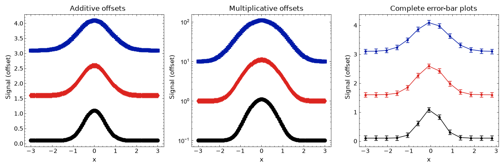

Offsetting Related Datasets
============================

The :py:class:`stonerplots.OffsetPlots` context manager separates related datasets
vertically on the same axes. It inspects the artists when the context exits,
so ordinary Matplotlib plotting commands need no changes::

    import matplotlib.pyplot as plt
    from stonerplots import OffsetPlots, SavedFigure

    with SavedFigure("offset.png"), OffsetPlots(offset=2):
        fig, ax = plt.subplots()
        for y in datasets:
            ax.plot(x, y)
            ax.scatter(x, y)

On each new axes, the first dataset stays in place and successive datasets have
``offset``, ``2 * offset``, etc. added to their y values. The default offset is
1 in y data units. Negative offsets stack downwards. This changes the artists'
data without modifying the arrays passed to Matplotlib.

Logarithmic Axes
----------------

If the y scale is logarithmic at context exit, ``factor`` replaces the additive
offset. The first dataset stays in place and successive datasets are multiplied
by ``factor``, ``factor ** 2``, etc. The default factor is 10::

    with OffsetPlots(factor=5):
        fig, ax = plt.subplots()
        ax.set_yscale("log")
        for y in datasets:
            ax.plot(x, y)

The factor must be finite and positive. A factor between 0 and 1 stacks
downwards. Set both ``offset`` and ``factor`` when creating linear and log axes
in the same context; each axes chooses the appropriate setting independently.

Pairing and Artist Selection
-----------------------------

By default, ``pair="auto"`` checks the number of line datasets and scatter
collections on each axes. If there are equal, nonzero numbers of both, the first
line is paired with the first scatter collection, and so on. Each pair receives
the same adjustment, even when all lines are drawn before all scatter points.
Pairing uses the order within each artist type, rather than labels or colours.

* ``pair=False`` treats every dataset separately, in overall creation order.
* ``pair=True`` requires equal, nonzero counts on every nonempty eligible axes.
  A mismatch raises ``ValueError`` before any datasets are moved.
* ``lines=False`` excludes lines and errorbar plots.
* ``scatter=False`` excludes scatter collections.
* ``errorbars=False`` excludes complete errorbar plots, including their data lines.

An ``ax.errorbar()`` plot counts as one line dataset. Its data line, caps, and
horizontal and vertical error segments all move together, including when
``fmt="none"`` suppresses the data line. Additive offsets preserve the error
size; multiplicative factors scale the y-error size with the y values. The
x values and x-error widths remain unchanged.

For example, three measurement series with uncertainties can be stacked without
manually adjusting either their values or their error bars::

    with OffsetPlots(offset=1.5):
        fig, ax = plt.subplots()
        for y, uncertainty in measurements:
            ax.errorbar(x, y, yerr=uncertainty, fmt="o-", capsize=3)

An errorbar plot and a separately drawn fit both count as line datasets, so they
are offset independently. Automatic pairing matches line datasets with scatter
collections.

Axes Discovery and Limits
-------------------------

Only axes created within the context are processed by default, including axes
added to an existing figure. Use ``include_open=True`` to process all open axes,
including artists drawn before entering the context. Each axes starts a fresh
offset sequence. A single dataset remains unchanged.

Data and view limits are refreshed after moving the artists, including scatter
and error-bar collections. Explicit limits and disabled autoscaling are
respected. The previously current figure and axes are restored on exit.
If plotting raises an exception, the manager leaves the datasets untouched and
propagates the exception. A manager can be reused; previously adjusted artists
selected again with ``include_open=True`` receive another adjustment.

Only ordinary 2D Cartesian axes with linear or logarithmic y scales are handled.
Polar and 3D axes and other y scales are skipped. Lines and scatter collections
must use data coordinates. Reference lines such as ``axhline()`` and ``axvline()``,
filled regions, images and other artist types are left in place. Empty ordinary
line and scatter artists are ignored.

The executable example ``examples/plot_examples/offset_plots.py`` demonstrates
paired measurements and fits on both linear and logarithmic axes.

.. literalinclude:: ../../examples/plot_examples/offset_plots.py
   :language: python
   :caption: Complete executable example

API
---

.. autoclass:: stonerplots.OffsetPlots
   :show-inheritance:
